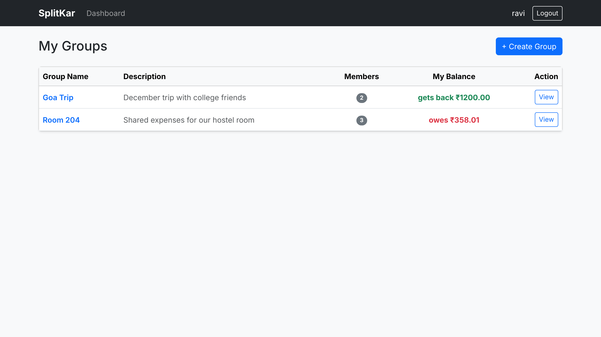
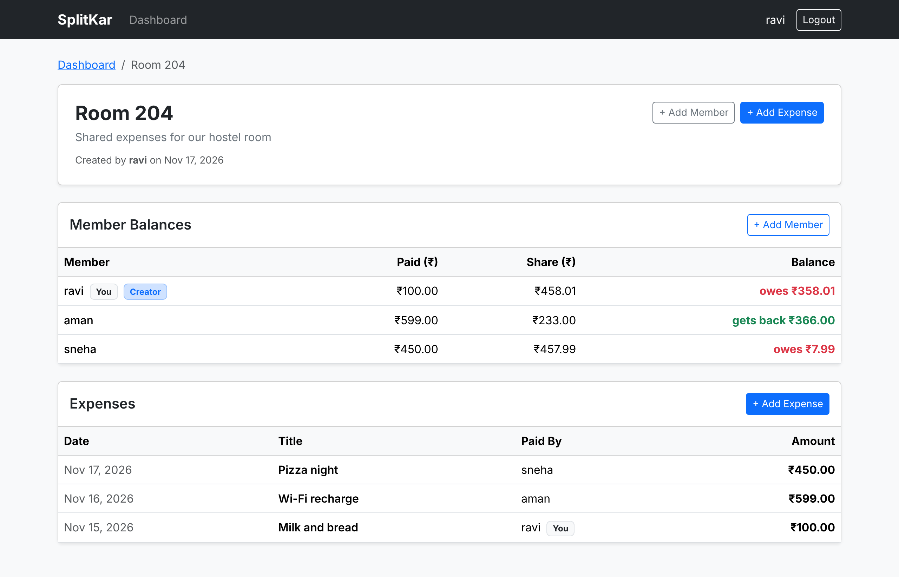
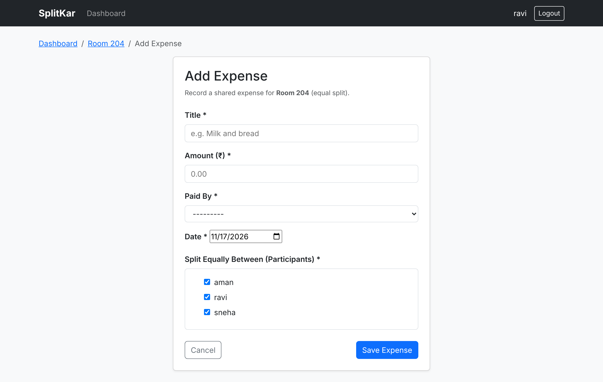

# SplitKar

A clean and simple Django web app designed for hostel roommates, flatmates, and trip groups to track shared spending and see who owes whom with running balances.

---

## What SplitKar Does

SplitKar enables friends to create shared groups (such as "Room 204" or "Goa Trip"), add members by username, and record expenses. When an expense is entered, the app splits it equally among chosen participants, ensures exact paisa rounding, and maintains a running net balance for each member.

---

## Screenshots

| Dashboard | Group & Balances | Add Expense |
|:---:|:---:|:---:|
|  |  |  |


---

## Setup and Installation

### 1. Prerequisites
- Python 3.11+
- Git

### 2. Create and Activate Virtual Environment

**Windows (PowerShell):**
```powershell
python -m venv venv
.\venv\Scripts\Activate.ps1
```

**Windows (Command Prompt):**
```cmd
python -m venv venv
venv\Scripts\activate.bat
```

**Linux / macOS:**
```bash
python3 -m venv venv
source venv/bin/activate
```

### 3. Install Dependencies
```bash
pip install -r requirements.txt
```

### 4. Apply Database Migrations
```bash
python manage.py migrate
```

### 5. Create Superuser (Admin Access)
```bash
python manage.py createsuperuser
```

### 6. Run the Development Server
```bash
python manage.py runserver
```

Open your browser and navigate to `http://127.0.0.1:8000/`.

---

## How to Run Tests

Run Django's built-in test runner:
```bash
python manage.py test
```

To run with verbose output:
```bash
python manage.py test -v 2
```

---

## Project Structure

```text
splitkar/
├── config/                  # Django project configuration
│   ├── __init__.py
│   ├── asgi.py
│   ├── settings.py          # Settings (reads SECRET_KEY and DEBUG from env)
│   ├── urls.py              # Root URL routing
│   └── wsgi.py
├── docs/                    # Documentation and screenshots
│   ├── add-expense.png
│   ├── dashboard.png
│   └── group.png
├── splitter/                # Core application
│   ├── migrations/          # Database migrations
│   │   ├── 0001_initial.py
│   │   └── 0002_expense_expenseshare.py
│   ├── __init__.py
│   ├── admin.py             # Admin panel registration
│   ├── apps.py              # App configuration
│   ├── forms.py             # ModelForms & validation
│   ├── models.py            # ExpenseGroup, Membership, Expense, ExpenseShare
│   ├── services.py          # Equal split and balance calculation logic
│   ├── tests.py             # Test suite
│   ├── urls.py              # Application URLs
│   └── views.py             # View controllers
├── templates/               # Bootstrap 5 HTML templates
│   ├── base.html            # Base layout with navbar and alerts
│   ├── registration/
│   │   ├── login.html       # Login page
│   │   └── signup.html      # Signup page
│   └── splitter/
│       ├── dashboard.html       # Groups dashboard & balances
│       ├── expense_create.html  # Add expense form
│       ├── group_create.html    # Create group form
│       ├── group_detail.html    # Group overview, balances & expenses
│       └── member_add.html      # Add member by username
├── .gitignore               # Ignores venv, db.sqlite3, __pycache__, .env
├── LICENSE                  # MIT license
├── manage.py                # Django CLI utility
├── README.md                # Project documentation
└── requirements.txt         # Pinned Django version
```

---

## How Balances and Equal Split Rounding Work

### Equal Split with Exact Rounding
- The total amount is divided by the number of participants and rounded down to 2 decimal places using Python's `Decimal` with `ROUND_DOWN` (never floats).
- Any leftover paise are distributed one paisa at a time:
  1. First to the **payer** if the payer is participating in the expense.
  2. Then to the **other participants** in alphabetical username order.
- This guarantees that the sum of individual shares matches the total expense amount down to the exact paisa.

### Member Balances
$$\text{Balance}(u) = \sum \text{Expenses Paid by } u - \sum \text{Shares Owed by } u$$

- **Positive balance**: The member is owed money &rarr; displayed as `gets back ₹X` in green.
- **Negative balance**: The member owes money &rarr; displayed as `owes ₹X` in red.
- **Zero balance**: The member is squared up &rarr; displayed as `settled` in gray.
- All balances within a group always sum to exactly ₹0.00.

---

## Current Limits

- Expenses are split equally only.
- An expense cannot be edited or deleted after it is added.
- The app shows each member's balance but not who should pay whom.
- Members cannot be removed, and groups cannot be deleted.
- No CSV import or export.
